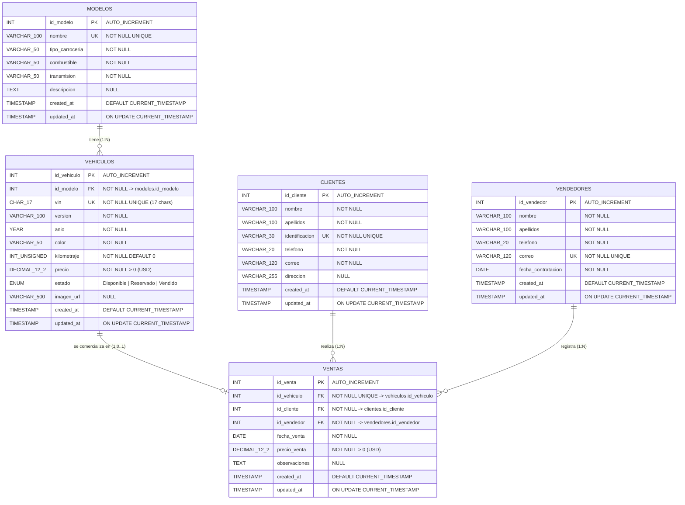

# Diagrama Entidad-Relación (DER) Inicial — BMW Premium Motors (Día 1)

**Base de datos:** `bmw_premium_motors`  
**Motor:** `MySQL 8+ (InnoDB)`  
**Codificación:** `utf8mb4` / `utf8mb4_unicode_ci`  
**Alcance de esta vista:** Exclusivamente las 5 entidades comerciales originales del **Día 1** (`modelos`, `vehiculos`, `clientes`, `vendedores`, `ventas`), previas a la incorporación de la tabla `usuarios` en el Día 2.

---

## 1. Diagrama Entidad-Relación (Mermaid ER)

---

## 2. Cardinalidades del Día 1
- **`modelos` 1:N `vehiculos`:** Un modelo agrupa múltiples unidades físicas en inventario; cada vehículo corresponde a un modelo BMW específico.
- **`clientes` 1:N `ventas`:** Un cliente puede adquirir uno o más vehículos en el concesionario.
- **`vendedores` 1:N `ventas`:** Un asesor comercial puede registrar múltiples operaciones de venta.
- **`vehiculos` 1:0..1 `ventas`:** Una unidad física de inventario puede o no estar vendida, pero gracias a la restricción `UNIQUE (id_vehiculo)` en la tabla `ventas`, jamás puede asignarse a más de una venta en toda la vida del sistema.
