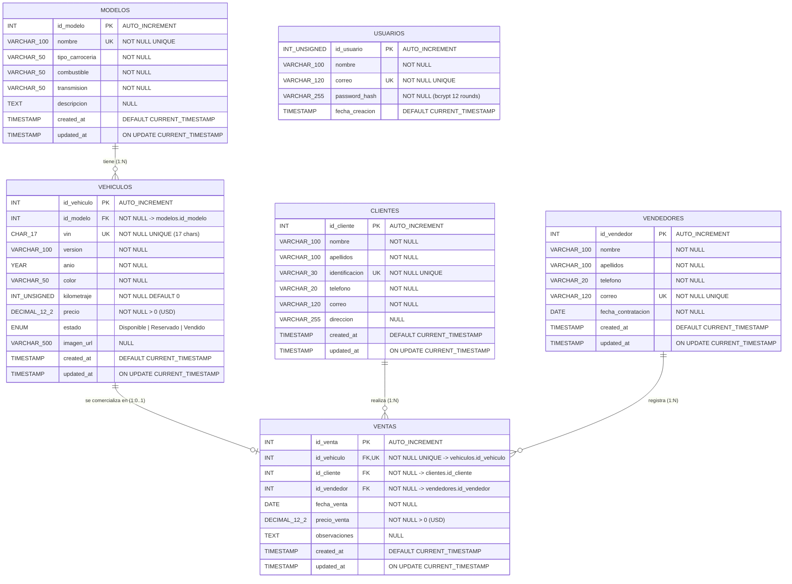

# Diagrama Entidad-Relación (DER) — BMW Premium Motors (Día 2)

**Base de datos:** `bmw_premium_motors`  
**Motor:** `MySQL 8+ (InnoDB)`  
**Codificación:** `utf8mb4` / `utf8mb4_unicode_ci`

---

## 1. Visión General del Modelo de Datos

En el **Día 2** se conservan íntegramente las cinco entidades comerciales del concesionario desarrolladas en el Día 1 (`modelos`, `vehiculos`, `clientes`, `vendedores`, `ventas`), junto con sus claves primarias, claves foráneas, restricciones de unicidad y reglas de integridad referencial (`ON DELETE RESTRICT`, `ON UPDATE CASCADE`), y se incorpora mediante migración incremental idempotente (`npm run db:migrate`) la sexta entidad independiente **`usuarios`** para autenticación mediante **JWT (`HS256`)** y contraseñas cifradas con **`bcrypt` (12 rondas)**.

> **Independencia arquitectónica de `usuarios`:** Conforme a los requerimientos del sistema, no existen roles ni permisos diferenciados por usuario, por lo que `usuarios` actúa como entidad transversal de acceso autenticado al sistema sin claves foráneas obligatorias hacia las operaciones comerciales.

---

## 2. Diagrama Entidad-Relación (Mermaid ER)

*(El código fuente puro exportable también se encuentra disponible en `docs/DER-dia-2.mmd`).*

---

## 3. Diccionario de Entidades y Reglas de Integridad

| Entidad | Clave Primaria | Campos Únicos (`UNIQUE`) | Claves Foráneas (`FOREIGN KEY`) | Reglas de Negocio Clave |
| :--- | :--- | :--- | :--- | :--- |
| **`modelos`** | `id_modelo` (`INT`) | `nombre` | Ninguna | No puede eliminarse (`HTTP 409`) mientras existan registros en `vehiculos` vinculados a ese modelo. |
| **`vehiculos`** | `id_vehiculo` (`INT`) | `vin` (`CHAR(17)`) | `id_modelo` → `modelos(id_modelo)` | `precio > 0` (USD), `kilometraje >= 0`. El estado `Vendido` solo se asigna/libera mediante transacciones en `ventas`. |
| **`clientes`** | `id_cliente` (`INT`) | `identificacion` | Ninguna | No puede eliminarse (`HTTP 409`) si posee compras registradas en `ventas`. |
| **`vendedores`** | `id_vendedor` (`INT`) | `correo` | Ninguna | No puede eliminarse (`HTTP 409`) si posee operaciones registradas en `ventas`. |
| **`ventas`** | `id_venta` (`INT`) | `id_vehiculo` | `id_vehiculo` → `vehiculos`, `id_cliente` → `clientes`, `id_vendedor` → `vendedores` | Ejecutada bajo transacciones SQL ACID (`FOR UPDATE`). Al crear marca el vehículo `Vendido`; al eliminar lo restaura a `Disponible`. |
| **`usuarios`** *(Día 2)* | `id_usuario` (`INT UNSIGNED`) | `correo` | Ninguna (entidad de autenticación independiente) | Contraseña almacenada exclusivamente como `password_hash` (`bcrypt`, 12 rondas). Nunca expone `password_hash` en la API. |

*(Adicionalmente, el ejecutor `backend/src/database/migrate.js` gestiona automáticamente la tabla técnica auxiliar `schema_migrations` para garantizar la idempotencia de las migraciones incrementales).*

