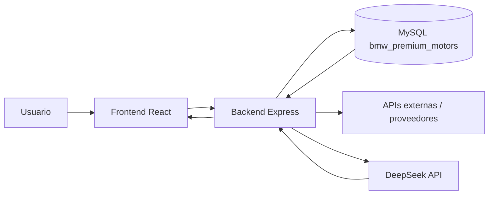

# ADR-0003: Los datos viven en MySQL y solo salen al proveedor de IA cuando el backend los necesita

- Estado: Aceptado
- Fecha: 2026-11-13
- Decide: Equipo técnico del proyecto y responsable de datos del concesionario

## Contexto

El sistema BMW Premium Motors maneja información operativa, de clientes, ventas, proveedores, vehículos, garantías, finanzas y asistente IA. La base de datos principal es MySQL y la integración con inteligencia artificial se hace desde el servidor. La documentación de este proyecto debe describir dónde vive cada conjunto de datos y qué información llega a proveedores externos.

## Decisión

- Base de datos principal: MySQL (`localhost:3306`) en la base `bmw_premium_motors`.
- Backend: Node.js + Express, con acceso a MySQL a través de `backend/src/config/db.js`.
- Frontend: React/Vite, que solo consume API REST; no guarda credenciales ni secretos de base de datos.
- Variables de entorno: se definen en `backend/.env.example` y deben mantenerse fuera del repositorio real, como `DB_HOST`, `DB_USER`, `DB_PASSWORD`, `JWT_SECRET`, `CORS_ORIGIN`, `DEEPSEEK_API_KEY` y `DEEPSEEK_MODEL`.
- Almacenamiento de archivos: la solución usa URLs de imágenes y referencias de activos; el proyecto no define un repositorio de archivos corporativos centralizado en el código, por lo que la ubicación exacta de documentos físicos queda pendiente de confirmar.
- Proveedor de IA: DeepSeek API, usado desde el backend para recibir prompts y responder con contexto del negocio.
- Logs y auditoría: la aplicación incluye tablas de auditoría y eventos del sistema, aunque la política de retención y el propietario de la auditoría requieren confirmación.
- Respaldo: no se observa una política o script formal de backup en el repositorio; el responsable de infraestructura debe confirmarlo.

Los flujos de datos siguen esta ruta:

- Usuario -> Frontend React -> Backend Express -> MySQL / servicios internos
- Usuario -> Frontend React -> Backend Express -> Proveedor de IA DeepSeek
- Backend -> MySQL -> contexto del agente IA -> respuesta al usuario

Se envían al proveedor de IA únicamente los datos necesarios para responder la consulta: contexto del concesionario, información del inventario, prompt del usuario y, en su caso, el historial reciente. No se envían contraseñas, tokens, secretos JWT ni credenciales del sistema.

## Alternativas descartadas

- Enviar la consulta directamente desde el navegador: se descartó porque expondría credenciales, rompería el control centralizado y complicaría la trazabilidad.
- Guardar todo en el cliente: se descartó porque la información es empresarial y sensible.
- Enviar todo el contenido de la base de datos al modelo: se descartó por riesgo de privacidad, costo y sobreexposición de la información.

## Consecuencias

La arquitectura mantiene la información sensible centralizada en el backend y en MySQL, reduciendo la superficie de exposición. El costo es que la integración de IA depende de un proveedor externo y requiere políticas de control y trazabilidad. El principal riesgo es la transferencia de una parte del contexto del negocio a un tercero, por lo que la decisión debe revisarse con el responsable de datos y el comité de seguridad.

## Cómo se verifica

La verificación se hace en:

- `backend/src/config/db.js` — conexión a MySQL.
- `backend/src/app.js` — rutas protegidas y flujo de backend.
- `backend/src/services/aiService.js` — contexto del concesionario y envío al proveedor de IA.
- `backend/.env.example` — variables de entorno y secretos del servidor.
- `backend/src/database/schema.sql` — tablas y estructuras de almacenamiento.

