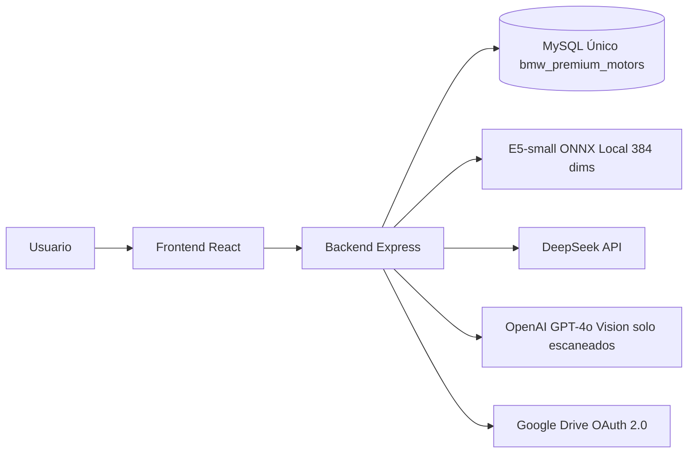

# ADR-0003: MySQL es la única base de datos y los datos solo salen del servidor cuando son necesarios

- Estado: Aceptado (Actualizado 2026-11-16)
- Fecha original: 2026-11-13
- Decide: Equipo técnico del proyecto y responsable de datos del concesionario

## Contexto

El sistema BMW Premium Motors y PolicyBot manejan catálogo automotriz, ventas, clientes, usuarios, empresas SaaS, documentos corporativos, fragmentos vectoriales de 384 dimensiones, historial RAG y tokens OAuth 2.0 de Google Drive. Mantener un único motor de base de datos relacional reduce riesgos operativos y evita migraciones destructivas.

## Decisión

- **Base de datos única oficial:** MySQL 8.0 (`localhost:3306`) en la base `bmw_premium_motors`, accedida mediante `backend/src/config/db.js`. No se utiliza un segundo motor de base de datos en ejecución.
- **Datos RAG en MySQL (`fragmentos`):** Los vectores de 384 dimensiones generados localmente con `Xenova/multilingual-e5-small` se almacenan en formato JSON junto con sus metadatos (`embedding_model`, `embedding_dimensions`, `embedding_version`, `indexed_at`) y un índice `FULLTEXT` sobre `contenido`. La búsqueda vectorial filtra primero por `id_empresa` en MySQL y calcula la similitud coseno en Node.js.
- **Tokens Google Drive OAuth 2.0 (`google_drive_connections`):** Los `access_token` y `refresh_token` se almacenan cifrados en MySQL mediante **AES-256-GCM** usando `TOKEN_ENCRYPTION_KEY` definida en `backend/.env`.
- **Frontend React/Vite:** Solo consume la API REST y SSE del backend con JWT en memoria; jamás almacena secretos de servidor ni API keys.

## Flujos de datos autorizados

## Cómo se verifica

- `backend/src/config/db.js` — único pool de base de datos (MySQL).
- `backend/src/database/migrations/004_policybot_multitenant_rag.sql` y `005_policybot_e5_384_oauth_drive.sql`.
- `backend/src/services/tokenCryptoService.js` — cifrado AES-256-GCM.
- `backend/src/services/localEmbeddingService.js` — inferencia local sin envío de fragmentos a APIs externas de embeddings.
